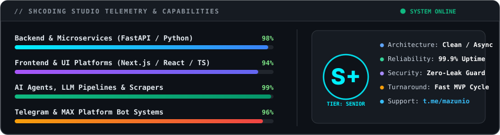

  <!-- Interactive Terminal Window Header -->
  

    

  <!-- High-Impact Direct Action Buttons -->
  

    
    
    
    
  

---

### 💼 НАШИ КЕЙСЫ &amp; РАЗРАБОТКА (SHCODING STUDIO)

  

  ↔️ <i>Листайте кейсы горизонтально (свайпом вбок или колесиком)</i> ↔️

<table>
  <tr>
    <td width="480px" align="center" valign="top">
      <h4>📱 1. Beauty Book</h4>
      
      

        ⚡ <b>Стек:</b> <code>FastAPI</code> • <code>Next.js</code> • <code>MAX Bot API</code> • <code>Docker</code> 
        🎯 <b>О проекте:</b> <i>Мини-апп внутри мессенджера MAX для мастеров. Онлайн-запись в 2 клика, личный кабинет, напоминания за 24ч и 2ч.</i>
      

    </td>
    <td width="480px" align="center" valign="top">
      <h4>🏢 2. Бот Домовой</h4>
      
      

        ⚡ <b>Стек:</b> <code>Python</code> • <code>Asyncio</code> • <code>Telegram Bot API</code> • <code>MAX</code> 
        🎯 <b>О проекте:</b> <i>Платформа рассылки объявлений по сотням домов за минуты для УК. Выбор адресов, автопересылка, контроль доставки.</i>
      

    </td>
    <td width="480px" align="center" valign="top">
      <h4>🥐 3. Babka Bakery</h4>
      
      

        ⚡ <b>Стек:</b> <code>Next.js</code> • <code>React</code> • <code>Tailwind CSS</code> • <code>API</code> 
        🎯 <b>О проекте:</b> <i>Цифровая витрина и предзаказ для пекарни-кофейни. Меню с фильтрами, корзина, карта маршрута.</i>
      

    </td>
  </tr>
</table>

---

### 🛠️ ТЕХНОЛОГИЧЕСКИЙ СТЕК

  

  

---

### 📊 ИНЖЕНЕРНЫЕ ПОКАЗАТЕЛИ &amp; ТЕЛЕМЕТРИЯ (SHCODING STUDIO)

  

---

### 🕹️ RETRO CYBER ARCADE // PAC-MAN 1984

  

  
  
  

