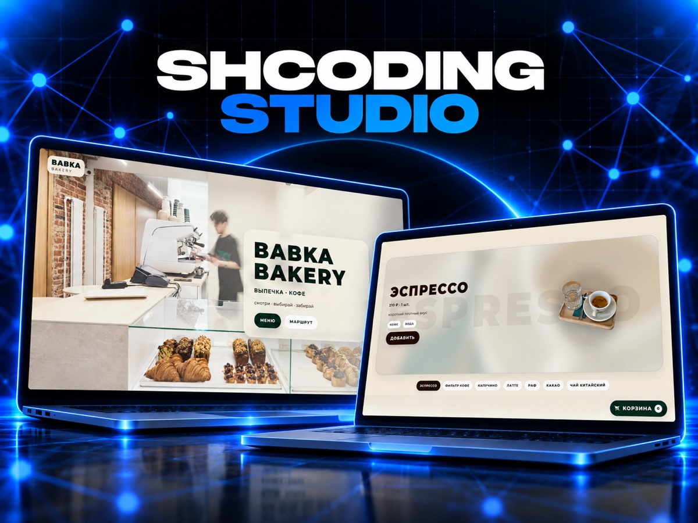

  <!-- Interactive Terminal Window Header -->
  

    

  <!-- High-Impact Direct Action Buttons -->
  

    
    
    
    
  

---

### 💼 НАШИ КЕЙСЫ &amp; РАЗРАБОТКА (SHCODING STUDIO)

  

 

#### 📱 1. Beauty Book — Онлайн-запись для мастеров внутри MAX
> *Мини-апп внутри мессенджера MAX для салонов красоты и частных мастеров. Каталог мастеров, выбор услуг, онлайн-календарь свободных окон, кабинет мастера и авто-уведомления.*

  

- ⚡ **Стек:** FastAPI, Next.js, MAX Bot API, PostgreSQL, Docker
- 🎯 **Функционал:** Карточка в каталоге, запись в 2 клика без переписки, напоминания клиентам за 24ч и 2ч, QR-визитка мастера.

 

#### 🏢 2. Бот Домовой — Рассылка объявлений по сотням домов за минуты
> *Платформа для управляющих компаний (УК) для централизованной отправки аварийных и плановых оповещений в домовые чаты MAX и Telegram.*

  

- ⚡ **Стек:** Python, Asyncio, Telegram Bot API, MAX Bot API, Webhook Manager
- 🎯 **Функционал:** Адресная отправка по выбранным домам, автопересылка постов из каналов, контроль доставки и раздельные доступы администраторов.

 

#### 🥐 3. Babka Bakery — Интерактивная витрина и предзаказ
> *Сайт-платформа и цифровая витрина для кофейни и ремесленной пекарни.*

  

- ⚡ **Стек:** Next.js, React, Tailwind CSS, API интеграции, корзина
- 🎯 **Функционал:** Динамическое меню кофе и выпечки с фильтрацией, корзина и предварительный заказ, интерактивный маршрут до заведения.

---

### 🛠️ ТЕХНОЛОГИЧЕСКИЙ СТЕК

  

  

---

### 📊 АКТИВНОСТЬ &amp; МЕТРИКИ GITHUB

  
  

---

### 🐍 CONTRIBUTION ACTIVITY

  <picture>
    <source media="(prefers-color-scheme: dark)" srcset="https://raw.githubusercontent.com/mazunai/mazunai/output/github-contribution-grid-snake-dark.svg">
    <source media="(prefers-color-scheme: light)" srcset="https://raw.githubusercontent.com/mazunai/mazunai/output/github-contribution-grid-snake.svg">
    
  </picture>

